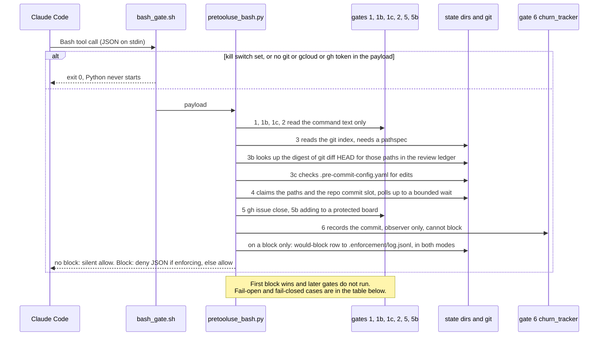
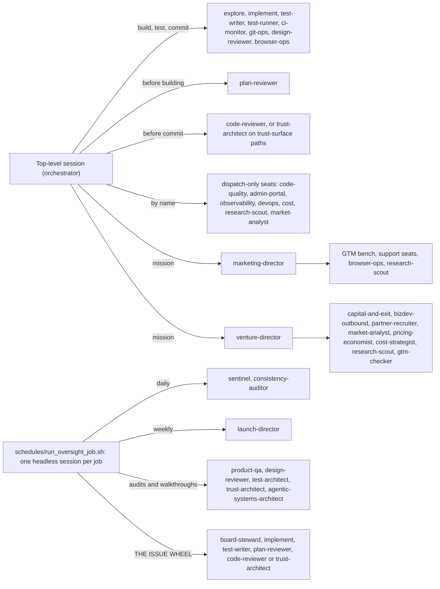

# Architecture

This repo is a `~/.claude/` directory for [Claude Code](https://claude.com/claude-code). It has
three layers: written rules for agents, hooks that enforce the rules agents break most, and agent
definitions plus the state files they leave behind. Unfamiliar words are defined in
[`GLOSSARY.md`](GLOSSARY.md). In this public repo, `CLAUDE.md §N` means `OPERATING_CONTRACT.md §N`.

## The three layers

| Layer | What it is | Where |
|---|---|---|
| 1. Operating contract | Plain-English rules: path-scoped commits, no stash or branch switching, review before commit, ask before push. | `CLAUDE.md` (four rules, read every session), `OPERATING_CONTRACT.md` (full text) |
| 2. Hooks and gates | Programs Claude Code runs before or after a tool call. They turn some rules into checks that can deny the call. | `hooks/`, registered by matcher in `settings.json` |
| 3. Agents and ledgers | 47 agent definitions, each pinned to a model; per-agent notes (primers) and per-repo grounding files (dossiers); and the state directories the hooks write. | `agents/`, `knowledge/`, `templates/oversight/`, `~/.claude/.<name>/` at run time |

Layer 1 enforces nothing by itself. Layer 2 enforces part of it: git state changes, unscoped
commits, unreviewed commits, overlapping commits, off-policy sub-agent models. No hook gates
`git push` (`_evaluate_git_argv` in `hooks/block_branch_ops.py` passes it through); push, PR, merge
and deploy are ask-gated by `permissions.ask` in `settings.json` and by contract §4.

**Log-only until you turn enforcement on.** In the Bash and Task dispatchers, a gate that blocks writes a `would-block` row to
`~/.claude/.enforcement/log.jsonl` in both modes (the Workflow gate and the Playwright guard log their own `deny` / `log-only` rows); only when enforcing does it also emit the deny,
and otherwise the call is allowed. Enforcement is on when `CSA_ENFORCE=1` is in the environment,
`~/.claude/.enforce` exists, or the nearest enclosing git repo has a `.claude/.csa-enforce` marker
(`enforcing` in `hooks/_lib.py`). `CSA_DISABLE_HOOKS=1` switches every hook off and wins over all of
them. A deny is a JSON object on stdout with exit code 0, never a nonzero exit (the POLICY section of
`hooks/pretooluse_bash.py`'s docstring). `CSA_ALLOW_GIT_STATE_OPS=1` in the hook's own environment
lets every git-state or gcloud-identity block (gates 1, 1b, 1c, 2) through, logged as
`escape-allowed`: a standing switch for that process, not a one-command override.

## The Bash gate chain

`hooks/bash_gate.sh` is a shell fast path: it starts Python only when the payload mentions `git`,
`gcloud`, `gh issue close` or `create`, a project-board shape, or the escape-variable name
(the `case` statement in `hooks/bash_gate.sh`). `hooks/pretooluse_bash.py` then reads the event once
and runs each gate's pure decision function in a fixed order. The first block wins (`resolve_block`).

| Gate | Denies | Fails closed on | Fails open on |
|---|---|---|---|
| 1 `block_branch_ops` | `checkout`, `switch`, `reset`, `rebase`, `clean`; `stash` except `list`/`show`; `restore` except `--staged`; `worktree` except `list`/`prune`/`repair`; branch delete; bulk `add`; `commit -a` | a git segment it cannot tokenize (`_evaluate_git_argv`); the escape variable's name written in the command (`decision`) | its own exception (`decision`) |
| 1b `block_head_overwrite` | `git show <ref>:<path> > <path>` and the `cat-file` form: a redirect that overwrites a file with its own old version | the escape variable's name written in the command (`decide`) | parse ambiguity (module docstring); its own exception (`decide`) |
| 1c `block_gcloud_identity` | `gcloud` commands that change the machine-wide account or credentials file; unmasked `describe`/`list` output that can carry secrets; `--log-http` | a gcloud segment it cannot tokenize (module docstring); a `--format` outside the per-resource allowlist; the escape variable's name in the command (`decision`) | its own exception (`decision`) |
| 2 `block_unscoped_commit` | bulk `add`, `commit -a` (same shapes as 1, separate message) | a git segment it cannot tokenize; the escape variable's name in the command (`decide`) | its own exception (`decide`) |
| 3 `check_staged_scope` | a writing `git commit` with no `-- <pathspec>` or a whole-tree one; a commit sweeping files outside its scope | nothing | its own exception (`decision_for_event`) |
| 3b `precommit_review_gate` | a commit whose pending content has no review on record, or a review with unresolved blockers | a pathspec it cannot resolve (`REASON_UNRESOLVABLE`), one outside the repo (`REASON_OUTSIDE_REPO`), or a `GIT_*_PATHSPECS` variable set (`REASON_PATHSPEC_ENV_SET`) | everything else: git error, unreadable ledger, empty diff (`decide`, docstring "FAIL-OPEN") |
| 3c `dirty_precommit_config`, in `pretooluse_bash.py` itself (`_dirty_precommit_config_block`) | a pathspec commit while `.pre-commit-config.yaml` has uncommitted edits, unless the pathspec names it | nothing | any error |
| 4 `file_claims` | a commit whose paths, or the repo's commit slot, another live agent holds | nothing | unreadable ledger, unacquirable lock or any error: the claim succeeds untracked (module docstring) |
| 5 `gh_issue_close_gate` | `gh issue close` citing a commit that does not exist, or claiming a deploy the commit never reached | a cited commit git cannot resolve for any reason (`commit_resolves`) | an ancestry question git cannot answer (`commit_is_ancestor` returns `None`) |
| 5b `protected_board_guard` | adding an item to a board in the protected-boards registry | a `gh` segment it cannot tokenize that has the add shape (`decide`) | registry missing or unparseable (module docstring) |
| 6 `churn_tracker` | nothing: logs `churn-flagged` when a path is committed repeatedly without a clean review | n/a | n/a |

The dispatcher itself fails closed when the hook JSON cannot be parsed and the raw text mentions git
or gcloud (`main`), and fails open on any other unexpected exception (`resolve_block`).
`issue_create_observer` logs but never blocks. **Known gap:** every gate that finds git by splitting
the command into segments (1, 2, 3, 3b, 3c, 4) sees `git` only as the command of a segment. A git
command inside a `bash -c`, `sh -c` or `eval` string is not seen: `eval "git stash"` and
`bash -c "git commit -m x"` both pass. Gate 1b scans the raw text but treats single-quoted spans as literal, so it misses a wrapped
redirect inside single quotes (`'…'` or `$'…'`); gate 5 sees none of them; gate 1c
re-parses those strings, but only for gcloud.

## The Task dispatcher and the Workflow gate

`hooks/pretooluse_task.py` runs on every sub-agent dispatch with two gates, in order.

- **T1, `model_pin_gate.py`.** Compares the dispatch's `model` with the agent's pin: its own
  frontmatter, else `knowledge/model_policy.json` `agent_pins`. It denies `pin-tier-mismatch`,
  `pin-inherit-drift` (no model given and no agent file to carry a pin, e.g. a built-in `Explore`),
  `unpinned-agent-type` and `missing-pin-in-file` (the `REASON_*` constants and the decision tree
  in the module docstring of `hooks/model_pin_gate.py`). A dispatch naming a different model than
  the pin passes only with a single-use token from `record_model_exception.py` bound to the SHA-256
  of that dispatch's prompt (`find_and_consume_exception`), or an operator-written grant file
  (`find_and_consume_operator_grant`); for a pinned agent, `fable` can come only from the grant (T1 does not check the model named for a type with no pin). It fails open if the
  policy or agents directory is unreadable (`decide`; module docstring, "FAIL-OPEN CONTRACT").
- **T2, `agent_budget.py gate`.** Runs only if T1 allowed, so a refused dispatch never takes a
  lease. Without `CSA_PACER=1` it only counts live agents. With it, it takes a lease under a lock,
  staggers launches with a token bucket, and denies above `CSA_ANTHROPIC_CEILING` when enforcing.
  On admission it appends a spend claim that `release_hook` joins into `spend.jsonl` when the agent
  stops. It fails open (`agent_budget.py` docstring, `gate`). So does the dispatcher: an exception
  in `main` of `pretooluse_task.py` allows the dispatch.

A saved `Workflow` script fans out with an in-script `agent()` call, which has no per-leg
PreToolUse event, so neither Task gate sees it first. `hooks/workflow_model_gate.py` (PreToolUse on
`Workflow`) denies a script, inline or read from `scriptPath`, in which any `agent()` call has no
literal `model:` key. It does not judge which model, allows options passed by variable or spread,
and fails open on any parse or IO error (`main`, `missing_model_lines`).

## Dispatch graph

Only the two department directors, `marketing-director` and `venture-director`, hold the `Agent`
tool (their `tools:` lines). A director has it only when a top-level session dispatches it directly:
inside a `Workflow` call the platform strips it, and the agents a director dispatches cannot
dispatch further (`knowledge/marketing_director_primer.md` §1, and §4, "How a director itself must
be dispatched"). Every other agent is dispatched by a top-level session or by a scheduled job's
headless session. Per-agent detail: [`docs/agents/README.md`](docs/agents/README.md).

The edges come from `schedules/prompts/*.txt` and the two directors' agent files. The wheel's
triage script, `workflows/issue-wheel-triage.js`, fans out sonnet-only readers inside one
`Workflow` call.

## State directories

All live under `~/.claude/` (except the per-repo `.csa-enforce` marker), are created at run time on first use, and are not tracked in this repo.

| Directory | Written by | Read by |
|---|---|---|
| `.enforce` (empty file); `<repo>/.claude/.csa-enforce` (per-repo marker) | the operator | `_lib.enforcing()` |
| `.enforcement/log.jsonl` | every hook, through `_lib.log` | `hooks/churn_report.py`, `scripts/enforcement_doctor.sh` |
| `.review_state/` (`last_reviewed`, `plan_reviews.jsonl`, `commit_authors`) | `record_review.py`, `record_plan_review.py`, `commit_authors.py` | gate 3b; gate 6; `agent_obligations.py` |
| `.file_claims/` | gate 4; released by `posttooluse_bash.py` after the commit | gate 4 in other sessions; `file_claims.py status` |
| `.agent_budget/` (leases, `claims.jsonl`, `stops.jsonl`, `spend.jsonl`) | `agent_budget.py` (T2, `release_hook`) | T2; `churn_report.py`; `agent_obligations.py`; `record_review.py` |
| `.model_exceptions/` | `record_model_exception.py`; `scripts/grant_model_exception.sh` (operator) | `model_pin_gate.py`, which spends each entry once |
| `.churn/` | gate 6 | `churn_tracker.py status` |
| `.agent_router_state/`, `.agent_obligations/` | `agent_router.py` (opt-in; not wired by default) | `agent_obligations.py` (Stop hook; opt-in) |
| `.lanes/lanes.jsonl` | `scripts/lane.sh` | `scripts/lane.sh`, the lane skills |
| `schedules/heartbeats/` | `schedules/run_oversight_job.sh` | `hooks/heartbeat_audit.py` |

## Life of one change

1. **Plan (substantial work).** `plan-reviewer` reads the plan. `hooks/record_plan_review.py` logs
   the outcome. Nothing blocks work without it.
2. **Edit.** A session or an `implement` agent edits the shared working tree. Edits are not gated.
3. **Classify.** `python3 ~/.claude/hooks/review_risk_tier.py <paths>` prints `trivial`, `moderate` or `high`
   with a reason. It is advice, not a hook. If the repo lists trust-surface globs, gate 3b names
   `trust-architect` as reviewer of record.
4. **Review.** The reviewer reads `git diff HEAD -- <paths>` and returns findings and a blocker
   count. It never edits. After fixes comes a narrower check; `docs/subsystems/review-ladder.md`
   has the round rules.
5. **Record.** Stage any new file first (staging moves the digest), then run
   `python3 ~/.claude/hooks/record_review.py <repo> --pre-commit --clean --paths <paths>`, or
   `--blockers <n>`. It appends a `precommit:<digest>` line and the outcome to
   `.review_state/last_reviewed`. In log-only mode it records nothing and exits 1
   (`hooks/record_review.py`, module docstring).
6. **Commit.** `git commit -F <msgfile> -- <paths>`. Gates 1 to 2 find nothing. Gate 3 sees an
   explicit pathspec. Gate 3b finds the digest with a clean outcome. Gate 4 claims the paths and the
   repo commit slot; if another live commit holds either, it polls, then denies naming the holder.
   Change a reviewed byte after step 5 and gate 3b denies again, by design.
7. **After.** `posttooluse_bash.py` releases the claim and records which session authored the new
   HEAD. An unreleased claim expires on its own: 300 s for paths, 60 s for the commit slot
   (`CSA_FILE_CLAIM_TTL_SEC` and `CSA_COMMIT_MUTEX_TTL_SEC` in `hooks/file_claims.py`).
8. **Push.** Not a hook decision. `permissions.ask` prompts the operator.

Most deny messages name the next step; gate 3b prints the exact `record_review.py` command.

## Read next

[`docs/subsystems/gate-chain.md`](docs/subsystems/gate-chain.md) ·
[`docs/subsystems/review-ladder.md`](docs/subsystems/review-ladder.md) ·
[`docs/subsystems/concurrency-and-claims.md`](docs/subsystems/concurrency-and-claims.md) ·
[`docs/subsystems/oversight-wheel.md`](docs/subsystems/oversight-wheel.md) ·
[`docs/README.md`](docs/README.md) (index with maturity tags). The suites run from a checkout that
is `$HOME/.claude`: `bash hooks/run_tests.sh`, or `scripts/ci_layout.sh` to build that layout for a
checkout elsewhere.
