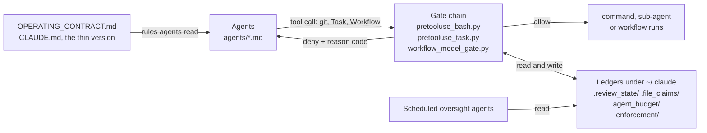

# Claude Agentic Runtime

Hooks, a review gate and a roster of agent definitions for [Claude Code](https://claude.com/claude-code) that make the
rules for a team of agents mechanical instead of advisory: agents sharing one repository are stopped from silently
overwriting each other, committing work nobody reviewed, or running up the bill on the wrong model.

**Who it is for:** anyone running several Claude Code agents or sessions against one real codebase, and teams whose
rollout has stalled on exactly those problems. With one agent in one checkout you do not need most of this. The
gates start in **log-only mode**: they record what they would have blocked and block nothing until you turn
enforcement on ([Install](#install)). The agent-router and obligation hooks (`agent_router.py`,
`agent_router_path.sh`, `agent_obligations.py`) are opt-in and not wired by default.

**What it is not:** a defence against an agent set on disabling it. The gates catch agent mistakes. An agent can
delete `~/.claude/.enforce`, edit `settings.json`, or wrap a command in `bash -c`, `sh -c` or `eval`, and the git
gates (1, 2, 3, 3b, 3c, 4) do not look inside those strings (a known gap; 1b misses a wrapped redirect inside single quotes). Want it installed and tuned for your
team? See [`docs/consulting.md`](docs/consulting.md).

## Three ideas that are original here

**1. A review bound to the exact bytes being committed** (`hooks/precommit_review_gate.py`, gate 3b). Before a
`git commit` runs, the gate hashes `git diff HEAD -- <the commit's own paths>` and looks the digest up in a ledger
(`~/.claude/.review_state/last_reviewed`) that `hooks/record_review.py` writes when a reviewer finishes. No entry
for that content: the commit is denied. Change one byte after the review and the digest moves, so the gate fires
again; a peer editing other files never invalidates it. It proves a review is on record, not that it was good.

**2. A claim ledger plus a commit mutex** (`hooks/file_claims.py`, gate 4 of `hooks/pretooluse_bash.py`). Each
`git commit` first claims its exact paths in `~/.claude/.file_claims/`. Claims are all-or-nothing, so an agent
never holds half its paths while waiting for the rest (no circular-wait deadlock), and a claim expires if its
holder dies. One extra per-repo token serializes commits even on disjoint paths, because pre-commit stashes the
whole working tree. `python3 hooks/file_claims.py status` shows who holds what.

**3. A model pin checked when the agent is dispatched** (`hooks/model_pin_gate.py`, gate T1 of
`hooks/pretooluse_task.py`). Each agent file pins a model; `knowledge/model_policy.json` holds the policy. A
dispatch can override the pin, and one that names no model inherits the parent session's, which is how an
expensive model leaks into every sub-agent. T1 denies an off-pin model unless a single-use, 15-minute token
(`hooks/record_model_exception.py`) bound to that exact prompt was minted first.

## What it blocks

Reason codes are the strings the code returns and logs to `~/.claude/.enforcement/log.jsonl`; each is asserted in
a file under `hooks/tests/`. There is no recorded demo yet.

| An agent tries | Gate | Verdict |
|---|---|---|
| `git stash`, `checkout`, `switch`, `reset`, `rebase`, `restore`, `clean` | 1 `block_branch_ops` | `state-verb:stash` (and so on per verb) |
| `git add -A`, `git commit -a` | 1 (gate 2 checks again) | `bulk-add`, `commit-all` |
| `git show HEAD:f > f` | 1b `block_head_overwrite` | `show-redirect-self-overwrite` |
| `gcloud config set account ...` | 1c `block_gcloud_identity` | `config-set-account` |
| `git commit -m x`, or the same with `-- .` | 3 `check_staged_scope` | `missing-pathspec`, `bulk-pathspec` |
| `git commit -m x -- a.txt` with no review on record, or one recorded with blockers | 3b | `unreviewed-commit`, `review-blockers-unresolved` |
| `git commit -- $SOME_VAR/a.txt` | 3b | `unresolvable-pathspec` (a recorded review cannot clear it) |
| commit on paths a live peer holds, or during a peer's commit | 4 `file_claims` | `contested-paths`, `commit-in-flight` |
| dispatch `code-reviewer` on `haiku` | T1 `model_pin_gate` | `pin-tier-mismatch` |
| dispatch `Explore`, `Plan`, `general-purpose` or an undefined agent type with no `model` | T1 | `pin-inherit-drift` |
| dispatch an agent file that carries no pin, with no `model` | T1 | `missing-pin-in-file` |

## How the pieces fit



Gates share state only through the ledgers. Fail-open and fail-closed per gate: [`ARCHITECTURE.md`](ARCHITECTURE.md).
Terms: [`GLOSSARY.md`](GLOSSARY.md).

## Repo map

| Path | What is in it | Tag |
|---|---|---|
| `hooks/` | the gate chain, the ledger code, the model-pin and spend gates, and `tests/` | core |
| `OPERATING_CONTRACT.md`, `CLAUDE.md` | the full rule set (sections 0-13); the short version injected every session | core |
| `settings.json`, `docs/` | template hook wiring plus `permissions`; `getting-started.md`, a design doc per subsystem, an explainer per agent | core |
| `ARCHITECTURE.md`, `GLOSSARY.md`, `CONTRIBUTING.md`, `SECURITY.md`, `CODE_OF_CONDUCT.md`, `CHANGELOG.md`, `SUPPORT.md`, `POSTMORTEM.md`, `docs/consulting.md`, `LICENSE`, `pyproject.toml` | project files; `pyproject.toml` holds the test extras and the ruff and pytest settings | core |
| `knowledge/`, `agents/` | `model_policy.json` (core), agent primers, incident histories and corpora; the agent definitions, one Markdown file each | optional |
| `scripts/`, `templates/` | `init_repo.sh` and `repo_manifest.py` wire a product repo from the dossier skeletons in `templates/`; also `gh_issue.sh`, `lane.sh`, `ci_layout.sh`, `disk_janitor.sh` | optional |
| `schedules/`, `workflows/`, `commands/`, `skills/` | launchd wrapper and prompts for unattended oversight runs; two saved `Workflow` scripts; `/sweep`, `/wheel`; the `lane-*` skills and `trim-memory` | optional |
| `telemetry/`, `live-testing/`, `statusline*.sh` | spend-ledger schema and pricing; a Playwright slot pool and example allowlist for `hooks/block_prod_mutations.py`; status-line scripts (need `jq`) | optional |
| `tools/` | `codex/` and `notification-sounds/`; `gtm/`, the go-to-market mission schema and convergence evaluator | `gtm/` experimental |
| `skills/gtm/`, the marketing and venture agents | the go-to-market and venture departments | experimental |

## Install

The hooks are wired by the path `~/.claude/hooks/...`, so they must live there.

**`~/.claude` does not exist yet** (a machine that has never run Claude Code): clone straight into place.

```bash
git clone https://github.com/1chrisshannon1-afk/claude-agentic-runtime-public ~/.claude
cd ~/.claude && scripts/init_repo.sh <path-to-your-product-repo>
```

**`~/.claude` already exists** (any machine that has run Claude Code, where the clone above fails): clone beside it
and merge by hand.

```bash
git clone https://github.com/1chrisshannon1-afk/claude-agentic-runtime-public ~/.claude-runtime
```

Then follow [`docs/getting-started.md`](docs/getting-started.md) section 1: copy `hooks/`, `knowledge/model_policy.json`
and `agents/` in without overwriting yours; merge the `hooks` block of `settings.json` into your own file instead of
replacing it; and copy its `permissions.ask` entries for `git push` and its force-push and token-printing
`permissions.deny` entries, because that is what gates a push. An installer script that does this merge is planned for the next release.

**Before turning enforcement on**, copy `live-testing/allowlist.example.json` to `live-testing/allowlist.json`. Without
it the Playwright guard (`hooks/block_prod_mutations.py`) denies every browser click, keystroke and form fill.

**Turn enforcement on** with any one of: an empty `~/.claude/.enforce` (every session), `CSA_ENFORCE=1` in one session's
environment, or an empty `<repo>/.claude/.csa-enforce` (one repo). `CSA_` is this project's environment-variable
prefix; `CSA_DISABLE_HOOKS=1` turns the gates off. **Check it** from `~/.claude` with the four gate-chain suites (they
need `pytest`; a virtual-environment recipe for Homebrew Python is in `docs/getting-started.md`):
`python3 -m pytest hooks/tests/test_block_branch_ops.py hooks/tests/test_check_staged_scope.py hooks/tests/test_precommit_review_gate.py hooks/tests/test_file_claims.py -q`.
The tests abort when they do not live under `~/.claude`; `scripts/ci_layout.sh` stages a checkout the way the planned
CI will (see `CONTRIBUTING.md`). On Linux set `PYTEST_ADDOPTS=--basetemp=/var/tmp/rt-pytest`: pytest's default temp
directory is under `/tmp`, and one of these tests uses `/tmp` as its "outside the repo" path.

## Guardrails

Every `git` command an agent runs passes through the numbered `PreToolUse:Bash` chain (`hooks/pretooluse_bash.py`);
first block wins. A parallel `PreToolUse:Task` chain gates every sub-agent dispatch. Test counts are `def test_`
functions in each gate's own file under `hooks/tests/`. Parse ambiguity fails closed: a git or gcloud segment that
cannot be tokenized, or a review pathspec that cannot be resolved, is blocked. A crash inside a gate's own code
fails open, and silently (no log row is written today), so one bug cannot wedge every Bash call. Detail:
[`docs/subsystems/gate-chain.md`](docs/subsystems/gate-chain.md).

| Gate | Blocks | Prevents | Tests |
|---|---|---|---|
| 1. `block_branch_ops` | `checkout`/`switch`/`stash`/`reset`/`rebase`/`restore`/`clean`, branch delete, bulk `add`, `commit -a` | Wiping a peer's uncommitted work with a state-changing git verb | 67 |
| 1b. `block_head_overwrite` | `git show <ref>:<path> > <path>` and the `cat-file` form | Lesson 3: git used as a read-only source to overwrite the working tree | 41 |
| 1c. `block_gcloud_identity` | `gcloud config set account`, `auth login`, ADC overwrites | One agent re-identifying every other session's `gcloud` calls (account and ADC are machine-wide) | 237 |
| 2. `block_unscoped_commit` | The bulk-add and `commit -a` shapes again, as a second check | Sweeping unrelated files into one commit | 54 |
| 3. `check_staged_scope` | A commit with no `-- <pathspec>`, or a whole-tree pathspec | "Commit everything" disguised as a pathspec | 102 |
| 3b. `precommit_review_gate` | A commit whose exact content has no recorded review, or unresolved blockers | Lesson 6: a review reported but never performed | 164 |
| 3c. `dirty_precommit_config` | A pathspec commit while `.pre-commit-config.yaml` is dirty | A doomed commit that burns a commit-mutex claim before failing | in `test_pretooluse_bash.py` (159) |
| 4. `file_claims` | A commit whose paths, or repo commit slot, a live peer holds | Overlapping commits and the shared stash window | 128 |
| 5. `gh_issue_close_gate` | `gh issue close` citing a fabricated sha or a deploy that did not happen | Closing an issue as fixed when it was not | 120 |
| 5b. `protected_board_guard` | Adding an item to a board listed in `knowledge/protected_boards.json` | Writing into a board reserved for another system | 72 |
| 6. `churn_tracker` | Nothing; observer | Paths landing changes without clean review, made measurable | 86 |
| T1. `model_pin_gate` (+ `record_model_exception`, which mints the single-use token it accepts) | A dispatch off its pinned model with no exception, or with no model at all | Lesson 23: the expensive model leaking into every sub-agent; a downgrade justified only by the caller's own say-so | 64 + 24 |
| T2. `agent_budget` gate | Fan-out beyond the rate-limit budget; blocks only with `CSA_PACER=1` and enforcement on, otherwise it only counts | A synchronized dispatch burst tripping the provider's rate limit | 304 |
| `pretooluse_task` | Nothing itself; runs T1, then T2, and fails open on its own error | A crashing dispatcher wedging every sub-agent call | 18 |
| `workflow_model_gate` | A `Workflow` call whose `agent()` sites name no `model:` | Workflow legs inherit the session model and bypass T1 and T2 | 13 |

## The agents

`agents/` holds the roster: one Markdown file per agent, with a `model`, a `tools` list and a description in its
frontmatter. Each has an explainer in [`docs/agents/`](docs/agents/); the index of every agent's model and trigger is
[`docs/agents/README.md`](docs/agents/README.md), generated by `scripts/gen_agent_index.py`.

**47 agents: 25 pinned to Opus, 20 to Sonnet, 2 to Haiku** (`scripts/gen_agent_index.py --summary`).
By group: development workflow 11, oversight roster 15, go-to-market department 15, venture department 5,
domain specialists 1.

| Group | Agents |
|---|---|
| Build | `implement`, `test-writer`, `explore`, `git-ops`, `test-runner`, `ci-monitor`, `browser-ops`, `design-reviewer` |
| Review gates | `plan-reviewer` (before a plan is executed) and `code-reviewer` (before a commit); both return findings and never edit |
| Oversight | `launch-director`, `board-steward`, `sentinel`, `consistency-auditor`, `test-architect`, `trust-architect`, `product-qa`, `agentic-systems-architect`, `code-quality-architect`, `admin-portal-architect`, `observability-architect`, `devops-architect`, `research-scout`, `market-analyst`, `cost-strategist` |
| Go-to-market (experimental) | `marketing-director` directing `conversion-architect`, `brand-architect`, `content-strategist`, `seo-architect`, `paid-acquisition-strategist`, `pricing-economist`, `video-producer`, `local-presence-architect`, `social-media-strategist`, `measurement-architect`, `revenue-ops-architect` and `market-analyst`; support seats `gtm-analyst`, `gtm-drafter`, `gtm-checker` |
| Venture (experimental) | `venture-director`, `capital-and-exit-strategist`, `bizdev-outbound-strategist`, `partner-recruiter`, `hiring-specialist` |
| Other | `session-coordinator` (integration lane, rarely used), `trading-strategist` (analysis only; no broker or order tooling) |

**Why reviewers and auditors pin to the strongest model and implementers do not.** A builder's mistake is caught
downstream, by a reviewer, a test or a gate. A reviewer's miss has nothing behind it, so that is where the strongest
model earns its cost; mechanical work and pollers get cheaper ones (reasoning: [`knowledge/model_policy.md`](knowledge/model_policy.md)).

Most teams should install the hooks and stop there: the oversight, go-to-market and venture agents are more than you
need on day one. My product-domain teams stay private; [the pattern](docs/patterns/estimate-feedback-loop.md) is public.

## Why it exists

I am not a professional developer. I run a remodeling company and shipped three production apps in about nine months
with Claude Code agents as my engineers. I built this to stop them destroying each other's work, reporting reviews
they never ran, and drifting onto the expensive model. Five incidents; the [post-mortem](POSTMORTEM.md) has 26 more.

1. **Git's pre-commit hook stashes the whole working tree**, not just the committed files. One agent's commit swept a
   peer's unstaged edits into the stash window. -> [Lesson 1](POSTMORTEM.md#1-two-agents-in-one-repository-will-overwrite-each-other)
2. **A shell redirect destroyed work git could not recover.** `git show HEAD:path > path` overwrote real uncommitted
   work: `git show` is read-only, the redirect was the damage. -> [Lesson 3](POSTMORTEM.md#3-one-shell-redirect-destroyed-work-that-git-could-not-recover)
3. **An agent reported a code review it never performed.** Fluent, specific, false; asking the code's author to check
   it does not fix that. -> [Lesson 6](POSTMORTEM.md#6-an-agent-reported-a-code-review-it-never-performed)
4. **The model setting silently reverted to the expensive tier four times.** The first time it ran two weeks unnoticed,
   on the order of tens of thousands of dollars at list price (a rough estimate of the token usage priced at list rates,
   not an invoiced amount); Claude Code itself rewrote the file. -> [Lesson 22](POSTMORTEM.md#22-the-model-setting-silently-reverted-four-times)
5. **Isolating every agent in its own git worktree was worse than the problem.** Five days after making it mandatory:
   six crashed sessions, 233 checkouts, 103 GB. -> [Lesson 17](POSTMORTEM.md#17-isolating-every-agent-was-worse-than-the-problem-it-solved)

## Status and caveats

- **The hook gates block nothing until you enable enforcement.** The agent-router and obligation hooks (`agent_router.py`,
  `agent_router_path.sh`, `agent_obligations.py`) are not wired by default; wiring them is opt-in. The `permissions`
  rules in `settings.json` (ask before `git push`, deny force-push and token-printing commands) apply at once.
- **Push, PR, merge and deploy are gated by `permissions.ask` plus the contract (`OPERATING_CONTRACT.md` section 4), not
  by the hook chain.** The chain does not inspect `git push`.
- **The gates catch agent mistakes, not an agent set on disabling them.** An agent can delete `~/.claude/.enforce`, edit
  `settings.json`, or wrap a command in `bash -c`, `sh -c` or `eval`; gates 1, 2, 3, 3b, 3c and 4 do not look inside
  those strings. Gate 1b scans the raw text but treats single-quoted spans as literal, so it catches a wrapped
  `bash -c "…"` and misses `bash -c '…'`; 1c re-parses them, for gcloud only; gate 5 (`gh issue close`) does not look
  inside them either. This is a known gap, so put the real boundary in review. This repo has not verified whether the
  client's `permissions` matcher looks inside `bash -c`, so do not rely on it for that.
- **The drift guard is opt-in.** `hooks/settings_drift_guard.py` restores `model` and `effortLevel` in `settings.json` to
  the last committed value at session start, and removes an uncommitted `modelSettings` block. The shipped
  `settings.json` does not wire it; add it as a `SessionStart` command hook. It needs `~/.claude` to be a git repo with
  `settings.json` committed, and it overrides a model you change on purpose.
- **`model_pin_gate` will surprise you on day one.** Under enforcement a dispatch with no `model` is denied when there is
  no agent file to take a pin from: the built-in `Explore` (capital E), `Plan`, `general-purpose` and any custom agent
  type you have not defined need an explicit `model`. Known gap: it also denies, rather than allows, a `Task` event with
  no parseable `tool_input`; strict-xfail cases in `hooks/tests/test_pretooluse_task.py` pin that.
- **Three known failing tests in the clean test layout.** `ci_layout.sh --run` ends with 3 red results and everything
  else green (8,613 + 394 + 8 executed). `hooks/tests/test_codex_review.py::TestRealInstallIsUnaffectedByTestMode::test_codex_available_real_install_ignores_test_mode`
  expects the real `codex_available.sh` refusal message, which differs in the layout's throwaway HOME. The two
  `tools/gtm/tests/test_gtm_company_registry.py::test_gtm_registry_*_is_gitignored` tests run `git check-ignore` inside
  `~/.claude`, which the layout extracts from `git archive` and so is not a git repository; they pass in a git
  checkout at `$HOME/.claude`. Fixing the layout to `git init` its `.claude` is a known follow-up.
- **macOS-tested; Linux CI is planned.** The gate chain is plain Python and git and should run on Linux; the scheduled
  oversight pieces use `launchd`; Windows is untested. The oversight roster and the go-to-market department are the
  least battle-tested pieces for their size: the gate chain has months of multi-agent collisions behind it, they have weeks.
- **Claude Code ships native equivalents for some of this** (`deliver`, `code-review`, `loop`, `schedule`; see
  [`skills-and-commands.md`](docs/subsystems/skills-and-commands.md)). The git-level enforcement underneath them is
  the part I know of nothing built in providing.

## Requirements and license

Python 3.9 or newer (the hooks use only the standard library), `git`, `gh` for the issue gates, and `pytest` (test
extras in `pyproject.toml`). macOS first; Linux in a later CI release. MIT; see [`LICENSE`](LICENSE).

## Consulting

I install and tune this for teams whose Claude Code rollout has stalled. Scope and starting prices:
[`docs/consulting.md`](docs/consulting.md). Contact: [@1chrisshannon1-afk](https://github.com/1chrisshannon1-afk).
