<!-- GENERATED by scripts/gen_agent_index.py. Do not edit by hand: change agents/*.md, knowledge/model_policy.json or knowledge/agent_meta.json, then run `python3 scripts/gen_agent_index.py`. -->
# Agent roster

This runtime ships 47 agents. An agent is one Markdown file in `agents/`: a short frontmatter block (`name`, `description`, `model`, `tools`) followed by the prompt the agent runs under. The `tools` line is the mechanical boundary: an agent cannot call a tool it was not granted, whatever its prompt says.

This page is generated and never edited by hand. Its sources are:

- `agents/*.md` frontmatter: name, model, tools and description, copied verbatim;
- `knowledge/model_policy.json` `agent_pins`: the model each agent is meant to run on. The generator fails when a file's `model:` disagrees with its pin. At run time the model-pin gate (`hooks/model_pin_gate.py`) checks sub-agent dispatches against it, but only while enforcement is on, and it allows a dispatch rather than block work when the policy file cannot be read. Workflow steps are not covered by that gate; a separate one (`hooks/workflow_model_gate.py`) only checks that a model is named;
- `knowledge/agent_meta.json`: each agent's department, trigger and dispatcher.

`python3 scripts/gen_agent_index.py` rewrites the page, `--check` exits non-zero when it is stale, and `--summary` prints the model split. An agent's name links to its own page in this directory when one exists.

## Model split

| Model | Agents |
|---|---|
| `opus` | 25 |
| `sonnet` | 20 |
| `haiku` | 2 |

Why the split: seats whose job is to judge other work (the commit-boundary reviewers, the deep auditors and architects, the department directors) pin to the strongest model, because a defect they miss ships unnoticed. Seats that execute a narrow, checked brief (implementers, test writers, git and routine sweeps) pin to a mid-tier model, because the review gates check their output. Pure pollers and runners pin to the cheapest.

## Dispatch map

Who starts which agent. An arrow from a dispatcher to a department box means the dispatcher starts the counted number of agents in it; an arrow between two agents means the first dispatches the second.

```mermaid
flowchart LR
  d_orchestrator["Orchestrating session"]
  d_scheduled_job["Scheduled job"]
  d_operator["Operator (by name or slash command)"]
  subgraph dept_dev["Development workflow"]
    a_browser_ops["browser-ops"]
    a_ci_monitor["ci-monitor"]
    a_code_reviewer["code-reviewer"]
    a_design_reviewer["design-reviewer"]
    a_explore["explore"]
    a_git_ops["git-ops"]
    a_implement["implement"]
    a_plan_reviewer["plan-reviewer"]
    a_session_coordinator["session-coordinator"]
    a_test_runner["test-runner"]
    a_test_writer["test-writer"]
  end
  subgraph dept_oversight["Oversight roster"]
    a_admin_portal_architect["admin-portal-architect"]
    a_agentic_systems_architect["agentic-systems-architect"]
    a_board_steward["board-steward"]
    a_code_quality_architect["code-quality-architect"]
    a_consistency_auditor["consistency-auditor"]
    a_cost_strategist["cost-strategist"]
    a_devops_architect["devops-architect"]
    a_launch_director["launch-director"]
    a_market_analyst["market-analyst"]
    a_observability_architect["observability-architect"]
    a_product_qa["product-qa"]
    a_research_scout["research-scout"]
    a_sentinel["sentinel"]
    a_test_architect["test-architect"]
    a_trust_architect["trust-architect"]
  end
  subgraph dept_marketing["Marketing (go-to-market) department"]
    a_brand_architect["brand-architect"]
    a_content_strategist["content-strategist"]
    a_conversion_architect["conversion-architect"]
    a_gtm_analyst["gtm-analyst"]
    a_gtm_checker["gtm-checker"]
    a_gtm_drafter["gtm-drafter"]
    a_local_presence_architect["local-presence-architect"]
    a_marketing_director["marketing-director"]
    a_measurement_architect["measurement-architect"]
    a_paid_acquisition_strategist["paid-acquisition-strategist"]
    a_pricing_economist["pricing-economist"]
    a_revenue_ops_architect["revenue-ops-architect"]
    a_seo_architect["seo-architect"]
    a_social_media_strategist["social-media-strategist"]
    a_video_producer["video-producer"]
  end
  subgraph dept_venture["Venture department"]
    a_bizdev_outbound_strategist["bizdev-outbound-strategist"]
    a_capital_and_exit_strategist["capital-and-exit-strategist"]
    a_hiring_specialist["hiring-specialist"]
    a_partner_recruiter["partner-recruiter"]
    a_venture_director["venture-director"]
  end
  subgraph dept_domain["Domain specialists"]
    a_trading_strategist["trading-strategist"]
  end
  d_orchestrator -->|"10 agents"| dept_dev
  d_orchestrator -->|"13 agents"| dept_oversight
  d_scheduled_job -->|"1 agent"| dept_dev
  d_scheduled_job -->|"8 agents"| dept_oversight
  d_operator -->|"1 agent"| dept_dev
  d_operator -->|"1 agent"| dept_marketing
  d_operator -->|"3 agents"| dept_venture
  d_operator -->|"1 agent"| dept_domain
  a_venture_director --> a_bizdev_outbound_strategist
  a_marketing_director --> a_brand_architect
  a_marketing_director --> a_browser_ops
  a_venture_director --> a_capital_and_exit_strategist
  a_marketing_director --> a_content_strategist
  a_marketing_director --> a_conversion_architect
  a_venture_director --> a_cost_strategist
  a_marketing_director --> a_gtm_analyst
  a_marketing_director --> a_gtm_checker
  a_venture_director --> a_gtm_checker
  a_marketing_director --> a_gtm_drafter
  a_marketing_director --> a_local_presence_architect
  a_marketing_director --> a_market_analyst
  a_venture_director --> a_market_analyst
  a_marketing_director --> a_measurement_architect
  a_marketing_director --> a_paid_acquisition_strategist
  a_venture_director --> a_partner_recruiter
  a_marketing_director --> a_pricing_economist
  a_venture_director --> a_pricing_economist
  a_marketing_director --> a_research_scout
  a_venture_director --> a_research_scout
  a_marketing_director --> a_revenue_ops_architect
  a_marketing_director --> a_seo_architect
  a_marketing_director --> a_social_media_strategist
  a_marketing_director --> a_video_producer
```

- **orchestrating session**: the session you are talking to. It dispatches an agent by name whenever the work calls for one.
- **scheduled job**: an unattended job started by the machine's scheduler (see `schedules/`), which dispatches the agent without a person in the loop.
- **operator**: the person running the runtime, who starts the agent by name or with a slash command such as `/gtm`.

## Roster

### Development workflow (11)

Builders, test and CI agents, and the two commit-boundary reviewers. The orchestrating session dispatches these as the work needs them.

| Agent | Model | Trigger | Dispatched by | Description |
|---|---|---|---|---|
| [`browser-ops`](browser-ops.md) | `sonnet` | One browser action on a pool slot the orchestrator has already leased | orchestrating session, [`marketing-director`](marketing-director.md) | Use when a task needs one leased Playwright pool slot driven for a specific staging/local browser action, with the slot number already assigned by the orchestrator. Returns structural facts only, never secrets/PII. Not for scripted persona walkthroughs (use product-qa) or self-claiming a slot. |
| [`ci-monitor`](ci-monitor.md) | `haiku` | A CI run needs polling to completion, with pass or fail and failure logs reported | orchestrating session | Use when a CI run needs polling to completion with pass/fail and failure logs reported. Never fixes, never commits, never runs local CI itself. Not for auditing pipeline design/speed/security (use git-ops) or running local-ci.sh (use test-runner or implement). |
| [`code-reviewer`](code-reviewer.md) | `opus` | Before every commit on a non-trust-surface pathspec; the pre-commit review gate requires it | orchestrating session | Use when a git commit on a non-trust-surface pathspec is about to land — the mandatory pre-commit review gate 3b requires it. Checks correctness, regressions, scope-creep, lock-in tests, missing docs; returns a blocker count. Never edits. Not for trust-surface paths (use trust-architect). |
| [`design-reviewer`](design-reviewer.md) | `sonnet` | A UI diff, page, component or mock needs review against the design system, before or as it is built | orchestrating session | Use when reviewing a UI diff, page, component, or mock against the design system and UX/accessibility heuristics before or as it is built. Advisory, read-only; never edits. Not for the public marketing site (use brand-architect) or a live staging walkthrough (use product-qa). |
| [`explore`](explore.md) | `sonnet` | Fast read-only codebase mapping when the answer is not already known | orchestrating session | Use when fast, read-only codebase exploration is needed — mapping structure, finding patterns, returning file paths and signatures — and the answer isn't already known. Never writes or fixes. Not for reviewing a pending commit (use code-reviewer) or implementing a change (use implement). |
| [`git-ops`](git-ops.md) | `sonnet` | A path-scoped local commit, an issue lifecycle step, PR text prep, or an on-demand CI audit | orchestrating session | Use when a path-scoped local commit, GitHub issue lifecycle step (create/transition/resolve), PR text prep, or an on-demand CI/workflow speed-security-safety audit is needed. Never git add -A; never pushes/merges/deploys without explicit go-ahead. Not for watching a single CI run (use ci-monitor). |
| [`implement`](implement.md) | `sonnet` | A multi-file or exploratory code change, on a file partition the orchestrator assigns | orchestrating session | Use when code needs writing or editing for a feature, fix, or refactor via targeted patch-based edits within an assigned file partition. Path-scoped; never touches git state or runs formatters. Not for writing the tests that prove the change (use test-writer) or committing it (use git-ops). |
| [`plan-reviewer`](plan-reviewer.md) | `opus` | Before implementing any substantial plan | orchestrating session, scheduled job | Use proactively before implementing any substantial plan — checks completeness, root-cause-vs-band-aid, blast-radius coverage, and contract compliance against the request. Returns findings only, never edits. Not for reviewing already-written code (use code-reviewer). |
| [`session-coordinator`](session-coordinator.md) | `sonnet` | Only when a live session is designated integration-lane coordinator for a multi-worktree effort (rare) | operator | Use when a live session is designated integration-lane coordinator for a multi-worktree effort (rare: worktrees are opt-in, not default). Applies MERGE CARDs, announces commit trains. Not for ordinary product work in the main tree, and not reliably Task-dispatchable for its own duty. |
| [`test-runner`](test-runner.md) | `haiku` | A named test suite needs running, or a flake check over N identical reruns | orchestrating session | Use when a named test suite needs running with pass/fail, coverage, and failure details reported, or flake-detection across N identical reruns is needed. Never fixes failures and never commits. Not for writing new tests (use test-writer) or auditing test-suite architecture (use test-architect). |
| [`test-writer`](test-writer.md) | `sonnet` | Right after or alongside an implement change, or to cover code that is already committed | orchestrating session | Use when unit/integration/E2E tests asserting intended behavior need writing, right after or alongside an implement change. Pairs every redirect/auth-gate test with a recovery test; proves falsifiability via verify_fix. Not for running a suite (use test-runner) or fixing code (use implement). |

### Oversight roster (15)

Watchers and auditors that judge the whole body of work rather than one change. Some run on a schedule and the rest are dispatched by name; they mostly return findings for the orchestrating session to act on.

| Agent | Model | Trigger | Dispatched by | Description |
|---|---|---|---|---|
| [`admin-portal-architect`](admin-portal-architect.md) | `opus` | Dispatch-only, no schedule | orchestrating session | Use when auditing the admin console/back-office: which pages actually work, silent empty results, dead routes, or hardcoded stub data. Verdicts WORKS/DEGRADED/DEAD/STUB per page; findings-only, dispatch-only. Not for commit review (use code-reviewer) or product ranking (use launch-director). |
| [`agentic-systems-architect`](agentic-systems-architect.md) | `opus` | Monthly audit, and on demand for agent-definition, feedback-loop and pipeline design | scheduled job, orchestrating session | Use proactively for any new or changed agent definition or agentic loop/pipeline design, plus monthly runtime audits. Judges decomposition, verification economics, grounding, gate friction, telemetry truth, pattern fit. Findings-only. Not for a hook diff at commit (use code-reviewer). |
| [`board-steward`](board-steward.md) | `sonnet` | Tracker cleanup (dedupe, re-triage, honest closes); run inside the nightly issue wheel's close phase, or directly | scheduled job, orchestrating session | Use when the GitHub issue tracker needs cleanup: deduping, re-triaging stale issues, honest closes, board-field hygiene. Writes only via gh_issue.sh; destructive closes need operator approval unless a standing close authorization applies. Not for filing a single new finding mid-task (just file it). |
| [`code-quality-architect`](code-quality-architect.md) | `opus` | Dispatch-only, no schedule; a monthly cadence is the intent | orchestrating session | Use when a monthly or on-demand audit of code structure, coupling, complexity, and tech-debt trend is needed, or a rule diff to the coding-standards doc is proposed. Verdicts from the deterministic debt scan; never a per-commit grade. Not for commit-boundary correctness review (use code-reviewer). |
| [`consistency-auditor`](consistency-auditor.md) | `sonnet` | The daily sweep's consistency slot | scheduled job | Use when hunting contradictions between repo docs, help copy, in-app text, backend behavior, and marketing claims about the same fact. Cites both sides, names the authoritative one. Read-only, dispatched on the daily sweep's consistency slot. Not for a single doc's staleness (just fix it). |
| [`cost-strategist`](cost-strategist.md) | `sonnet` | A FinOps audit of vendor, cloud and AI spend; dispatch-only | orchestrating session, [`venture-director`](venture-director.md) | Use when a FinOps audit of vendor/cloud/AI spend is needed — vendor tally, waste by class, keep/kill/downgrade frames. Every figure sourced with an as-of date; read-only always. Not for ranking engineering work (use launch-director) or ad-spend effectiveness (use paid-acquisition-strategist). |
| [`devops-architect`](devops-architect.md) | `opus` | Dispatch-only, no schedule | orchestrating session | Use when a delivery/infrastructure audit is needed — IaC drift, container supply chain, environment parity, release/rollback safety, DORA metrics. Findings-only, read-only, never deploys. Not for CI pipeline speed/internals (use git-ops) or a single CI run's status (use ci-monitor). |
| [`launch-director`](launch-director.md) | `opus` | Weekly scheduled report, and on demand | scheduled job, orchestrating session | Use when the weekly (or on-demand) state-of-the-app verdict is needed: ranking all work against the shortest path to the app's one goal, and killing gold-plating. Returns rankings/reports; never edits or files issues. Not for cost waste analysis (use cost-strategist). |
| [`market-analyst`](market-analyst.md) | `opus` | A competitor or market delta sweep for one product; dispatch-only | orchestrating session, [`marketing-director`](marketing-director.md), [`venture-director`](venture-director.md) | Use when a delta-against-baseline competitor or industry-market sweep for one product is needed, or a specific competitor-move question arises. Every changed fact cites a URL; supplies inputs to launch-director, never ranks. Not for OSS/technical prior-art research (use research-scout). |
| [`observability-architect`](observability-architect.md) | `opus` | Dispatch-only, no schedule | orchestrating session | Use when a logging/observability audit is needed — structured-logger adoption, correlation-id coverage, error classification, alert-to-signal traceability, dead telemetry. Findings-only. Not for commit logging checks (use code-reviewer) or agent-loop telemetry (use agentic-systems-architect). |
| [`product-qa`](product-qa.md) | `sonnet` | Weekly and after a deploy: a scripted staging walkthrough as a customer persona | scheduled job, orchestrating session | Use when a scripted staging walkthrough of the live app as a customer persona is needed, with screenshots and severity-scored findings. Staging only, pool-claimed browser slot with guaranteed release; never production. Not for reviewing a diff/mock before it's built (use design-reviewer). |
| [`research-scout`](research-scout.md) | `sonnet` | A pre-plan prior-art check, or an OSS discovery sweep; dispatch-only | orchestrating session, [`marketing-director`](marketing-director.md), [`venture-director`](venture-director.md) | Use when a pre-plan OSS prior-art check or 'is there a maintained library for X?' consult is needed before building new capability. Verdicts each finding COPY/LEARN-FROM/AVOID against a verified license. Never writes code or files issues. Not for market/competitor facts (use market-analyst). |
| [`sentinel`](sentinel.md) | `sonnet` | Daily sweep and the heartbeat audit of every scheduled job | scheduled job | Use when one scheduled sweep dimension (health, logs, cost) or the daily heartbeat audit of scheduled jobs is due. Returns findings for board-steward to file; never files, fixes, or dispatches itself. Not for a scripted browser walkthrough (use product-qa) or a cost decision (use cost-strategist). |
| [`test-architect`](test-architect.md) | `opus` | Monthly audit, and on demand | scheduled job, orchestrating session | Use when a monthly or on-demand audit of whether the test suite proves intent (not current behavior) and logs are stranger-debuggable is needed. Interprets the test-quality scan's deltas; never a commit gate. Not for writing tests (use test-writer) or running a suite (use test-runner). |
| [`trust-architect`](trust-architect.md) | `opus` | Monthly security audit, and as reviewer of record in place of code-reviewer on trust-surface commits | scheduled job, orchestrating session | Use proactively as reviewer-of-record, instead of code-reviewer, when a commit touches auth, tenancy, billing, secrets, webhooks or an agent's tool grants; also monthly security audits. Never edits. Not for mid-edit checks or non-trust-surface commits (use code-reviewer). |

### Marketing (go-to-market) department (15)

One director agent runs a mission through a fixed lifecycle and dispatches a bench of specialist seats. The specialists return findings, specs or drafts; none of them edits product files.

| Agent | Model | Trigger | Dispatched by | Description |
|---|---|---|---|---|
| [`brand-architect`](brand-architect.md) | `opus` | A mission phase that reviews a marketing surface's visual identity | [`marketing-director`](marketing-director.md) | Use when reviewing or specifying a marketing surface's visual identity — type scale, color, spacing, logo usage, or a 'real company vs template' verdict. Findings/specs-only; never edits files. Not for in-app product UI (use design-reviewer) or funnel-conversion effect (use conversion-architect). |
| [`content-strategist`](content-strategist.md) | `opus` | A mission phase that needs headlines, page copy, email sequences or video scripts | [`marketing-director`](marketing-director.md) | Use when writing or reviewing headlines, page copy, email/lifecycle sequences, the voice guide, or video narration scripts. Findings/drafts-only; never publishes. Not for page structure/CTA (use conversion-architect) or short social captions/replies (use gtm-drafter). |
| [`conversion-architect`](conversion-architect.md) | `opus` | A mission phase that reviews public funnel surfaces: offers, calls to action, signup friction | [`marketing-director`](marketing-director.md) | Use when reviewing a public funnel surface — marketing site, pricing/signup/comparison pages, landing variants — for conversion friction. Ranked findings with a prescribed fix spec; never edits or rewrites copy. Not for visual polish (use brand-architect) or in-app UX (use design-reviewer). |
| [`gtm-analyst`](gtm-analyst.md) | `sonnet` | Turns handed-over exports and screenshots into scoreboard values and the weekly report | [`marketing-director`](marketing-director.md) | Use when handed-over marketing exports, screenshots, or collector outputs for one GTM company need turning into scoreboard values, a weekly report, or an ads-vs-CRM reconciliation. Read-only, no Bash/browser, never changes anything. Not for defining what a metric means (use measurement-architect). |
| [`gtm-checker`](gtm-checker.md) | `sonnet` | Checks a marketing or venture draft against its claims, AI-content and compliance checklist | [`marketing-director`](marketing-director.md), [`venture-director`](venture-director.md) | Use when a marketing or venture draft (reply, post, outreach email, listing text) needs checking against its claims/AI-content/compliance/identity checklist before it goes out. Pass/fail with reasons; never the drafter, never edits. Not for strategy calls (use the owning specialist). |
| [`gtm-drafter`](gtm-drafter.md) | `sonnet` | Drafts short-form pieces: review replies, social captions, listing text | [`marketing-director`](marketing-director.md) | Use when a short-form marketing piece for one company needs drafting — a review reply, social caption, listing text, or short update — from the shared doctrine and company pack. Proposals only; never publishes or checks its own work. Not for long-form copy or scripts (use content-strategist). |
| [`local-presence-architect`](local-presence-architect.md) | `opus` | A mission phase that covers local listings, name-address-phone consistency and review-response policy | [`marketing-director`](marketing-director.md) | Use when reviewing or specifying Google Business Profile, Yelp, Angi, Thumbtack, or other local-listing/NAP consistency, or judging a review-response draft's severity. Findings/specs only; never posts. Not for the website's own SEO (use seo-architect) or reply wording (use gtm-drafter). |
| [`marketing-director`](marketing-director.md) | `opus` | Mission dispatch through the /gtm skill; no schedule | operator | Use when launching or running a GTM marketing mission (e.g. 'a highly converting website', 'ad campaigns ready'). Runs intake-clarify-plan-produce-converge-present; dispatches the marketing bench; holds no Write/Edit tool. Not for selling the company or fundraising (use venture-director). |
| [`measurement-architect`](measurement-architect.md) | `opus` | A mission phase that specifies analytics events, tag management, consent and metric definitions | [`marketing-director`](marketing-director.md) | Use when specifying or auditing GA4 events, GTM container governance, consent mode, call tracking, the UTM standard, or a company's own metric definitions (what counts as 'a lead'). Findings/specs only; never publishes a container. Not for ad-spend/CAC math (use paid-acquisition-strategist). |
| [`paid-acquisition-strategist`](paid-acquisition-strategist.md) | `opus` | A mission phase that specifies ad account structure, budgets and CAC/LTV math; advisory only | [`marketing-director`](marketing-director.md) | Use when specifying or auditing Google Ads/Meta/LSA account structure, budgets, bid strategy, or CAC/LTV math. Advisory only, zero write access to any ad platform; every spec ships built-paused. Not for organic search (use seo-architect) or ad-spend accounting (use cost-strategist). |
| [`pricing-economist`](pricing-economist.md) | `opus` | A mission phase that challenges a company's COGS basis or price position, or needs CAC/LTV inputs | [`marketing-director`](marketing-director.md), [`venture-director`](venture-director.md) | Use when a company's own COGS basis or subscription price position needs challenging, or CAC/LTV inputs are needed — never to reprice. Findings-only. Not for estimate/catalog item pricing (engine work), vendor spend (use cost-strategist) or ad budgets (use paid-acquisition-strategist). |
| [`revenue-ops-architect`](revenue-ops-architect.md) | `opus` | A mission phase that audits speed-to-lead, lead routing, CRM hygiene and follow-up cadences | [`marketing-director`](marketing-director.md) | Use when auditing or specifying a company's own speed-to-lead, lead routing, CRM hygiene, follow-up cadences, or close rate. Findings/specs only; never contacts a lead. Not for building the product's CRM/lead features (use implement) or outbound prospecting (use bizdev-outbound-strategist). |
| [`seo-architect`](seo-architect.md) | `opus` | A mission phase that audits crawlability, schema markup, page speed and keyword gaps | [`marketing-director`](marketing-director.md) | Use when auditing or specifying technical SEO — crawlability, JSON-LD/schema, Core Web Vitals, sitemap/robots, keyword/content-gap briefs, site-level local SEO. Findings-only. Not for GBP/listings/reviews (use local-presence-architect) or paid keywords (use paid-acquisition-strategist). |
| [`social-media-strategist`](social-media-strategist.md) | `opus` | A mission phase that plans organic social: calendar, format mix, cadence caps | [`marketing-director`](marketing-director.md) | Use when planning or auditing organic Facebook/Instagram/LinkedIn/Shorts content — the monthly calendar, format mix, cadence caps, DM policy. Findings/calendars only; never posts or replies. Not for paid/boosted social (use paid-acquisition-strategist) or caption drafting (use gtm-drafter). |
| [`video-producer`](video-producer.md) | `opus` | A mission phase that plans a video's shots and screen flow, or reviews a rendered cut | [`marketing-director`](marketing-director.md) | Use when planning a video's shot list, b-roll relevance, screen-flow task script, or reviewing a rendered cut before upload. Findings/specs-only; never runs the recorder or renders. Not for narration copy (use content-strategist) or static-asset visual identity (use brand-architect). |

### Venture department (5)

A director agent runs one company's money missions (recruiting, exit or raise, outbound) and dispatches its bench. These seats research and draft; they never send, sign or spend.

| Agent | Model | Trigger | Dispatched by | Description |
|---|---|---|---|---|
| [`bizdev-outbound-strategist`](bizdev-outbound-strategist.md) | `sonnet` | Planning outbound B2B outreach and relationship sequences inside a venture mission | [`venture-director`](venture-director.md) | Use when planning outbound B2B outreach, cold-email campaigns, or relationship-building with partners/brokers/associations for one company (find a co-founder is partner-recruiter's lane). Drafts, lists, plans only; never sends. Not for inbound customer leads (use revenue-ops-architect). |
| [`capital-and-exit-strategist`](capital-and-exit-strategist.md) | `opus` | Exit paths, valuation ranges, deal structure and buyer materials inside a venture mission | [`venture-director`](venture-director.md) | Use when planning to sell the company, raise funding, or size a co-founder equity offer — exit paths, acquirer/investor maps, valuation ranges, deal structure, data-room content. Findings/drafts only; never signs or sends. Not for outbound outreach execution (use bizdev-outbound-strategist). |
| [`hiring-specialist`](hiring-specialist.md) | `sonnet` | Staff hiring for one company, from role requirements to offer drafts; dispatched by name | operator | Use when a company needs to hire staff — role requirements, a job post for Indeed or other boards, applicant screening, interview guides, offer or onboarding drafts. Drafts only; never posts, messages or decides. Not for co-founders (use partner-recruiter) or sourcing a subcontractor for a job. |
| [`partner-recruiter`](partner-recruiter.md) | `sonnet` | Shortlisting and outreach drafts for a co-founder or advisor | [`venture-director`](venture-director.md), operator | Use when a co-founder or advisor candidate for one company needs shortlisting or outreach drafting. Drafts and research only; never sends, posts, or states equity/pay in writing. Not for hiring staff (use hiring-specialist) or investor search (use capital-and-exit-strategist). |
| [`venture-director`](venture-director.md) | `opus` | Mission dispatch by name; no schedule | operator | Use when launching or running a venture-department mission for one company — recruiting a founding team, selling the company, raising funds, or outbound relationship building. Dispatches its specialist bench; never sends/signs/spends. Not for a marketing/GTM mission (use marketing-director). |

### Domain specialists (1)

Specialists for one product domain. Each is grounded in a repo's own dossier and primers rather than in runtime-wide doctrine.

| Agent | Model | Trigger | Dispatched by | Description |
|---|---|---|---|---|
| [`trading-strategist`](trading-strategist.md) | `sonnet` | A second opinion on a candidate equities or ag-futures trade, in a repo with a trading engine; dispatched by name | operator | Use when a second opinion on a candidate equities or ag-futures trade is needed, or a thesis needs stress-testing, in a repo with a trading engine. Produces data/analysis only — never sizes, sets a stop, or places an order. Holds no broker or write tooling of any kind. |

## Tool grants

The `tools` line of each agent's frontmatter, verbatim. An agent can use only the tools listed here.

| Agent | Tools |
|---|---|
| `admin-portal-architect` | Read, Grep, Glob, Bash |
| `agentic-systems-architect` | Read, Grep, Glob, Bash |
| `bizdev-outbound-strategist` | Read, Grep, Glob, WebFetch, WebSearch |
| `board-steward` | Read, Grep, Glob, Bash |
| `brand-architect` | Read, Grep, Glob, Bash, WebFetch, WebSearch |
| `browser-ops` | Read, ToolSearch, mcp__playwright-01__browser_navigate, mcp__playwright-01__browser_snapshot, mcp__playwright-01__browser_click, mcp__playwright-01__browser_type, mcp__playwright-01__browser_fill_form, mcp__playwright-01__browser_select_option, mcp__playwright-01__browser_hover, mcp__playwright-01__browser_press_key, mcp__playwright-01__browser_wait_for, mcp__playwright-01__browser_navigate_back, mcp__playwright-01__browser_tabs, mcp__playwright-01__browser_take_screenshot, mcp__playwright-01__browser_resize, mcp__playwright-01__browser_console_messages, mcp__playwright-01__browser_network_requests, mcp__playwright-01__browser_handle_dialog, mcp__playwright-01__browser_file_upload, mcp__playwright-01__browser_close, mcp__playwright-02__browser_navigate, mcp__playwright-02__browser_snapshot, mcp__playwright-02__browser_click, mcp__playwright-02__browser_type, mcp__playwright-02__browser_fill_form, mcp__playwright-02__browser_select_option, mcp__playwright-02__browser_hover, mcp__playwright-02__browser_press_key, mcp__playwright-02__browser_wait_for, mcp__playwright-02__browser_navigate_back, mcp__playwright-02__browser_tabs, mcp__playwright-02__browser_take_screenshot, mcp__playwright-02__browser_resize, mcp__playwright-02__browser_console_messages, mcp__playwright-02__browser_network_requests, mcp__playwright-02__browser_handle_dialog, mcp__playwright-02__browser_file_upload, mcp__playwright-02__browser_close, mcp__playwright-03__browser_navigate, mcp__playwright-03__browser_snapshot, mcp__playwright-03__browser_click, mcp__playwright-03__browser_type, mcp__playwright-03__browser_fill_form, mcp__playwright-03__browser_select_option, mcp__playwright-03__browser_hover, mcp__playwright-03__browser_press_key, mcp__playwright-03__browser_wait_for, mcp__playwright-03__browser_navigate_back, mcp__playwright-03__browser_tabs, mcp__playwright-03__browser_take_screenshot, mcp__playwright-03__browser_resize, mcp__playwright-03__browser_console_messages, mcp__playwright-03__browser_network_requests, mcp__playwright-03__browser_handle_dialog, mcp__playwright-03__browser_file_upload, mcp__playwright-03__browser_close, mcp__playwright-04__browser_navigate, mcp__playwright-04__browser_snapshot, mcp__playwright-04__browser_click, mcp__playwright-04__browser_type, mcp__playwright-04__browser_fill_form, mcp__playwright-04__browser_select_option, mcp__playwright-04__browser_hover, mcp__playwright-04__browser_press_key, mcp__playwright-04__browser_wait_for, mcp__playwright-04__browser_navigate_back, mcp__playwright-04__browser_tabs, mcp__playwright-04__browser_take_screenshot, mcp__playwright-04__browser_resize, mcp__playwright-04__browser_console_messages, mcp__playwright-04__browser_network_requests, mcp__playwright-04__browser_handle_dialog, mcp__playwright-04__browser_file_upload, mcp__playwright-04__browser_close, mcp__playwright-05__browser_navigate, mcp__playwright-05__browser_snapshot, mcp__playwright-05__browser_click, mcp__playwright-05__browser_type, mcp__playwright-05__browser_fill_form, mcp__playwright-05__browser_select_option, mcp__playwright-05__browser_hover, mcp__playwright-05__browser_press_key, mcp__playwright-05__browser_wait_for, mcp__playwright-05__browser_navigate_back, mcp__playwright-05__browser_tabs, mcp__playwright-05__browser_take_screenshot, mcp__playwright-05__browser_resize, mcp__playwright-05__browser_console_messages, mcp__playwright-05__browser_network_requests, mcp__playwright-05__browser_handle_dialog, mcp__playwright-05__browser_file_upload, mcp__playwright-05__browser_close, mcp__playwright-06__browser_navigate, mcp__playwright-06__browser_snapshot, mcp__playwright-06__browser_click, mcp__playwright-06__browser_type, mcp__playwright-06__browser_fill_form, mcp__playwright-06__browser_select_option, mcp__playwright-06__browser_hover, mcp__playwright-06__browser_press_key, mcp__playwright-06__browser_wait_for, mcp__playwright-06__browser_navigate_back, mcp__playwright-06__browser_tabs, mcp__playwright-06__browser_take_screenshot, mcp__playwright-06__browser_resize, mcp__playwright-06__browser_console_messages, mcp__playwright-06__browser_network_requests, mcp__playwright-06__browser_handle_dialog, mcp__playwright-06__browser_file_upload, mcp__playwright-06__browser_close, mcp__playwright-07__browser_navigate, mcp__playwright-07__browser_snapshot, mcp__playwright-07__browser_click, mcp__playwright-07__browser_type, mcp__playwright-07__browser_fill_form, mcp__playwright-07__browser_select_option, mcp__playwright-07__browser_hover, mcp__playwright-07__browser_press_key, mcp__playwright-07__browser_wait_for, mcp__playwright-07__browser_navigate_back, mcp__playwright-07__browser_tabs, mcp__playwright-07__browser_take_screenshot, mcp__playwright-07__browser_resize, mcp__playwright-07__browser_console_messages, mcp__playwright-07__browser_network_requests, mcp__playwright-07__browser_handle_dialog, mcp__playwright-07__browser_file_upload, mcp__playwright-07__browser_close, mcp__playwright-08__browser_navigate, mcp__playwright-08__browser_snapshot, mcp__playwright-08__browser_click, mcp__playwright-08__browser_type, mcp__playwright-08__browser_fill_form, mcp__playwright-08__browser_select_option, mcp__playwright-08__browser_hover, mcp__playwright-08__browser_press_key, mcp__playwright-08__browser_wait_for, mcp__playwright-08__browser_navigate_back, mcp__playwright-08__browser_tabs, mcp__playwright-08__browser_take_screenshot, mcp__playwright-08__browser_resize, mcp__playwright-08__browser_console_messages, mcp__playwright-08__browser_network_requests, mcp__playwright-08__browser_handle_dialog, mcp__playwright-08__browser_file_upload, mcp__playwright-08__browser_close, mcp__playwright-09__browser_navigate, mcp__playwright-09__browser_snapshot, mcp__playwright-09__browser_click, mcp__playwright-09__browser_type, mcp__playwright-09__browser_fill_form, mcp__playwright-09__browser_select_option, mcp__playwright-09__browser_hover, mcp__playwright-09__browser_press_key, mcp__playwright-09__browser_wait_for, mcp__playwright-09__browser_navigate_back, mcp__playwright-09__browser_tabs, mcp__playwright-09__browser_take_screenshot, mcp__playwright-09__browser_resize, mcp__playwright-09__browser_console_messages, mcp__playwright-09__browser_network_requests, mcp__playwright-09__browser_handle_dialog, mcp__playwright-09__browser_file_upload, mcp__playwright-09__browser_close, mcp__playwright-10__browser_navigate, mcp__playwright-10__browser_snapshot, mcp__playwright-10__browser_click, mcp__playwright-10__browser_type, mcp__playwright-10__browser_fill_form, mcp__playwright-10__browser_select_option, mcp__playwright-10__browser_hover, mcp__playwright-10__browser_press_key, mcp__playwright-10__browser_wait_for, mcp__playwright-10__browser_navigate_back, mcp__playwright-10__browser_tabs, mcp__playwright-10__browser_take_screenshot, mcp__playwright-10__browser_resize, mcp__playwright-10__browser_console_messages, mcp__playwright-10__browser_network_requests, mcp__playwright-10__browser_handle_dialog, mcp__playwright-10__browser_file_upload, mcp__playwright-10__browser_close, mcp__playwright-11__browser_navigate, mcp__playwright-11__browser_snapshot, mcp__playwright-11__browser_click, mcp__playwright-11__browser_type, mcp__playwright-11__browser_fill_form, mcp__playwright-11__browser_select_option, mcp__playwright-11__browser_hover, mcp__playwright-11__browser_press_key, mcp__playwright-11__browser_wait_for, mcp__playwright-11__browser_navigate_back, mcp__playwright-11__browser_tabs, mcp__playwright-11__browser_take_screenshot, mcp__playwright-11__browser_resize, mcp__playwright-11__browser_console_messages, mcp__playwright-11__browser_network_requests, mcp__playwright-11__browser_handle_dialog, mcp__playwright-11__browser_file_upload, mcp__playwright-11__browser_close, mcp__playwright-12__browser_navigate, mcp__playwright-12__browser_snapshot, mcp__playwright-12__browser_click, mcp__playwright-12__browser_type, mcp__playwright-12__browser_fill_form, mcp__playwright-12__browser_select_option, mcp__playwright-12__browser_hover, mcp__playwright-12__browser_press_key, mcp__playwright-12__browser_wait_for, mcp__playwright-12__browser_navigate_back, mcp__playwright-12__browser_tabs, mcp__playwright-12__browser_take_screenshot, mcp__playwright-12__browser_resize, mcp__playwright-12__browser_console_messages, mcp__playwright-12__browser_network_requests, mcp__playwright-12__browser_handle_dialog, mcp__playwright-12__browser_file_upload, mcp__playwright-12__browser_close |
| `capital-and-exit-strategist` | Read, Grep, Glob, WebFetch, WebSearch |
| `ci-monitor` | Bash, Read |
| `code-quality-architect` | Read, Grep, Glob, Bash |
| `code-reviewer` | Read, Grep, Glob, Bash |
| `consistency-auditor` | Read, Grep, Glob, Bash |
| `content-strategist` | Read, Grep, Glob, Bash, WebFetch, WebSearch |
| `conversion-architect` | Read, Grep, Glob, Bash, WebFetch, WebSearch |
| `cost-strategist` | Read, Grep, Glob, Bash, WebFetch, WebSearch |
| `design-reviewer` | Read, Grep, Glob, Bash |
| `devops-architect` | Read, Grep, Glob, Bash |
| `explore` | Read, Glob, Grep, Bash |
| `git-ops` | Bash, Read, Glob, Grep |
| `gtm-analyst` | Read, Grep, Glob |
| `gtm-checker` | Read, Grep, Glob |
| `gtm-drafter` | Read, Grep, Glob |
| `hiring-specialist` | Read, Grep, Glob, WebFetch, WebSearch |
| `implement` | Read, Edit, Write, Bash, Glob, Grep |
| `launch-director` | Read, Grep, Glob, Bash |
| `local-presence-architect` | Read, Grep, Glob, Bash, WebFetch, WebSearch |
| `market-analyst` | Read, Grep, Glob, Bash, WebFetch, WebSearch |
| `marketing-director` | Read, Grep, Glob, Bash, Agent |
| `measurement-architect` | Read, Grep, Glob, Bash, WebFetch, WebSearch |
| `observability-architect` | Read, Grep, Glob, Bash |
| `paid-acquisition-strategist` | Read, Grep, Glob, Bash, WebFetch, WebSearch |
| `partner-recruiter` | Read, Grep, Glob, WebFetch, WebSearch |
| `plan-reviewer` | Read, Grep, Glob, Bash |
| `pricing-economist` | Read, Grep, Glob, Bash, WebFetch, WebSearch |
| `product-qa` | Read, Grep, Glob, Bash, ToolSearch, mcp__playwright-01__browser_navigate, mcp__playwright-01__browser_snapshot, mcp__playwright-01__browser_click, mcp__playwright-01__browser_type, mcp__playwright-01__browser_fill_form, mcp__playwright-01__browser_select_option, mcp__playwright-01__browser_hover, mcp__playwright-01__browser_press_key, mcp__playwright-01__browser_wait_for, mcp__playwright-01__browser_navigate_back, mcp__playwright-01__browser_tabs, mcp__playwright-01__browser_take_screenshot, mcp__playwright-01__browser_resize, mcp__playwright-01__browser_console_messages, mcp__playwright-01__browser_network_requests, mcp__playwright-01__browser_handle_dialog, mcp__playwright-01__browser_file_upload, mcp__playwright-01__browser_close, mcp__playwright-02__browser_navigate, mcp__playwright-02__browser_snapshot, mcp__playwright-02__browser_click, mcp__playwright-02__browser_type, mcp__playwright-02__browser_fill_form, mcp__playwright-02__browser_select_option, mcp__playwright-02__browser_hover, mcp__playwright-02__browser_press_key, mcp__playwright-02__browser_wait_for, mcp__playwright-02__browser_navigate_back, mcp__playwright-02__browser_tabs, mcp__playwright-02__browser_take_screenshot, mcp__playwright-02__browser_resize, mcp__playwright-02__browser_console_messages, mcp__playwright-02__browser_network_requests, mcp__playwright-02__browser_handle_dialog, mcp__playwright-02__browser_file_upload, mcp__playwright-02__browser_close, mcp__playwright-03__browser_navigate, mcp__playwright-03__browser_snapshot, mcp__playwright-03__browser_click, mcp__playwright-03__browser_type, mcp__playwright-03__browser_fill_form, mcp__playwright-03__browser_select_option, mcp__playwright-03__browser_hover, mcp__playwright-03__browser_press_key, mcp__playwright-03__browser_wait_for, mcp__playwright-03__browser_navigate_back, mcp__playwright-03__browser_tabs, mcp__playwright-03__browser_take_screenshot, mcp__playwright-03__browser_resize, mcp__playwright-03__browser_console_messages, mcp__playwright-03__browser_network_requests, mcp__playwright-03__browser_handle_dialog, mcp__playwright-03__browser_file_upload, mcp__playwright-03__browser_close, mcp__playwright-04__browser_navigate, mcp__playwright-04__browser_snapshot, mcp__playwright-04__browser_click, mcp__playwright-04__browser_type, mcp__playwright-04__browser_fill_form, mcp__playwright-04__browser_select_option, mcp__playwright-04__browser_hover, mcp__playwright-04__browser_press_key, mcp__playwright-04__browser_wait_for, mcp__playwright-04__browser_navigate_back, mcp__playwright-04__browser_tabs, mcp__playwright-04__browser_take_screenshot, mcp__playwright-04__browser_resize, mcp__playwright-04__browser_console_messages, mcp__playwright-04__browser_network_requests, mcp__playwright-04__browser_handle_dialog, mcp__playwright-04__browser_file_upload, mcp__playwright-04__browser_close, mcp__playwright-05__browser_navigate, mcp__playwright-05__browser_snapshot, mcp__playwright-05__browser_click, mcp__playwright-05__browser_type, mcp__playwright-05__browser_fill_form, mcp__playwright-05__browser_select_option, mcp__playwright-05__browser_hover, mcp__playwright-05__browser_press_key, mcp__playwright-05__browser_wait_for, mcp__playwright-05__browser_navigate_back, mcp__playwright-05__browser_tabs, mcp__playwright-05__browser_take_screenshot, mcp__playwright-05__browser_resize, mcp__playwright-05__browser_console_messages, mcp__playwright-05__browser_network_requests, mcp__playwright-05__browser_handle_dialog, mcp__playwright-05__browser_file_upload, mcp__playwright-05__browser_close, mcp__playwright-06__browser_navigate, mcp__playwright-06__browser_snapshot, mcp__playwright-06__browser_click, mcp__playwright-06__browser_type, mcp__playwright-06__browser_fill_form, mcp__playwright-06__browser_select_option, mcp__playwright-06__browser_hover, mcp__playwright-06__browser_press_key, mcp__playwright-06__browser_wait_for, mcp__playwright-06__browser_navigate_back, mcp__playwright-06__browser_tabs, mcp__playwright-06__browser_take_screenshot, mcp__playwright-06__browser_resize, mcp__playwright-06__browser_console_messages, mcp__playwright-06__browser_network_requests, mcp__playwright-06__browser_handle_dialog, mcp__playwright-06__browser_file_upload, mcp__playwright-06__browser_close, mcp__playwright-07__browser_navigate, mcp__playwright-07__browser_snapshot, mcp__playwright-07__browser_click, mcp__playwright-07__browser_type, mcp__playwright-07__browser_fill_form, mcp__playwright-07__browser_select_option, mcp__playwright-07__browser_hover, mcp__playwright-07__browser_press_key, mcp__playwright-07__browser_wait_for, mcp__playwright-07__browser_navigate_back, mcp__playwright-07__browser_tabs, mcp__playwright-07__browser_take_screenshot, mcp__playwright-07__browser_resize, mcp__playwright-07__browser_console_messages, mcp__playwright-07__browser_network_requests, mcp__playwright-07__browser_handle_dialog, mcp__playwright-07__browser_file_upload, mcp__playwright-07__browser_close, mcp__playwright-08__browser_navigate, mcp__playwright-08__browser_snapshot, mcp__playwright-08__browser_click, mcp__playwright-08__browser_type, mcp__playwright-08__browser_fill_form, mcp__playwright-08__browser_select_option, mcp__playwright-08__browser_hover, mcp__playwright-08__browser_press_key, mcp__playwright-08__browser_wait_for, mcp__playwright-08__browser_navigate_back, mcp__playwright-08__browser_tabs, mcp__playwright-08__browser_take_screenshot, mcp__playwright-08__browser_resize, mcp__playwright-08__browser_console_messages, mcp__playwright-08__browser_network_requests, mcp__playwright-08__browser_handle_dialog, mcp__playwright-08__browser_file_upload, mcp__playwright-08__browser_close, mcp__playwright-09__browser_navigate, mcp__playwright-09__browser_snapshot, mcp__playwright-09__browser_click, mcp__playwright-09__browser_type, mcp__playwright-09__browser_fill_form, mcp__playwright-09__browser_select_option, mcp__playwright-09__browser_hover, mcp__playwright-09__browser_press_key, mcp__playwright-09__browser_wait_for, mcp__playwright-09__browser_navigate_back, mcp__playwright-09__browser_tabs, mcp__playwright-09__browser_take_screenshot, mcp__playwright-09__browser_resize, mcp__playwright-09__browser_console_messages, mcp__playwright-09__browser_network_requests, mcp__playwright-09__browser_handle_dialog, mcp__playwright-09__browser_file_upload, mcp__playwright-09__browser_close, mcp__playwright-10__browser_navigate, mcp__playwright-10__browser_snapshot, mcp__playwright-10__browser_click, mcp__playwright-10__browser_type, mcp__playwright-10__browser_fill_form, mcp__playwright-10__browser_select_option, mcp__playwright-10__browser_hover, mcp__playwright-10__browser_press_key, mcp__playwright-10__browser_wait_for, mcp__playwright-10__browser_navigate_back, mcp__playwright-10__browser_tabs, mcp__playwright-10__browser_take_screenshot, mcp__playwright-10__browser_resize, mcp__playwright-10__browser_console_messages, mcp__playwright-10__browser_network_requests, mcp__playwright-10__browser_handle_dialog, mcp__playwright-10__browser_file_upload, mcp__playwright-10__browser_close, mcp__playwright-11__browser_navigate, mcp__playwright-11__browser_snapshot, mcp__playwright-11__browser_click, mcp__playwright-11__browser_type, mcp__playwright-11__browser_fill_form, mcp__playwright-11__browser_select_option, mcp__playwright-11__browser_hover, mcp__playwright-11__browser_press_key, mcp__playwright-11__browser_wait_for, mcp__playwright-11__browser_navigate_back, mcp__playwright-11__browser_tabs, mcp__playwright-11__browser_take_screenshot, mcp__playwright-11__browser_resize, mcp__playwright-11__browser_console_messages, mcp__playwright-11__browser_network_requests, mcp__playwright-11__browser_handle_dialog, mcp__playwright-11__browser_file_upload, mcp__playwright-11__browser_close, mcp__playwright-12__browser_navigate, mcp__playwright-12__browser_snapshot, mcp__playwright-12__browser_click, mcp__playwright-12__browser_type, mcp__playwright-12__browser_fill_form, mcp__playwright-12__browser_select_option, mcp__playwright-12__browser_hover, mcp__playwright-12__browser_press_key, mcp__playwright-12__browser_wait_for, mcp__playwright-12__browser_navigate_back, mcp__playwright-12__browser_tabs, mcp__playwright-12__browser_take_screenshot, mcp__playwright-12__browser_resize, mcp__playwright-12__browser_console_messages, mcp__playwright-12__browser_network_requests, mcp__playwright-12__browser_handle_dialog, mcp__playwright-12__browser_file_upload, mcp__playwright-12__browser_close |
| `research-scout` | Read, Grep, Glob, Bash, WebFetch, WebSearch |
| `revenue-ops-architect` | Read, Grep, Glob, Bash, WebFetch, WebSearch |
| `sentinel` | Read, Grep, Glob, Bash |
| `seo-architect` | Read, Grep, Glob, Bash, WebFetch, WebSearch |
| `session-coordinator` | Bash, Read, Write, Glob, Grep |
| `social-media-strategist` | Read, Grep, Glob, Bash, WebFetch, WebSearch |
| `test-architect` | Read, Grep, Glob, Bash |
| `test-runner` | Bash, Read, Glob, Grep |
| `test-writer` | Read, Edit, Write, Bash, Glob, Grep |
| `trading-strategist` | Read, Grep, Glob, Bash |
| `trust-architect` | Read, Grep, Glob, Bash |
| `venture-director` | Read, Grep, Glob, Agent |
| `video-producer` | Read, Grep, Glob, Bash, WebFetch, WebSearch |
